<div align="center">

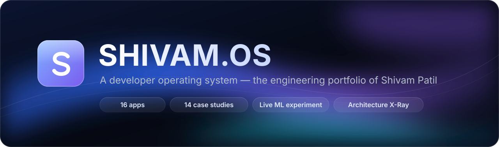

<br />

**An iOS-inspired desktop in the browser where every app is a piece of real engineering evidence.**<br />
Case studies, architecture X-rays, research and a live ML experiment — each claim linked to where it can be checked.

<br />

<a href="https://shivam-os.vercel.app"></a>
<a href="https://shivam-os.vercel.app/recruiter"></a>
<a href="https://shivam-os.vercel.app/resume"></a>

<br />

<a href="https://github.com/shivampatil4972/Shivam_OS/actions/workflows/ci.yml"></a>


<br /><br />


</div>

<br />

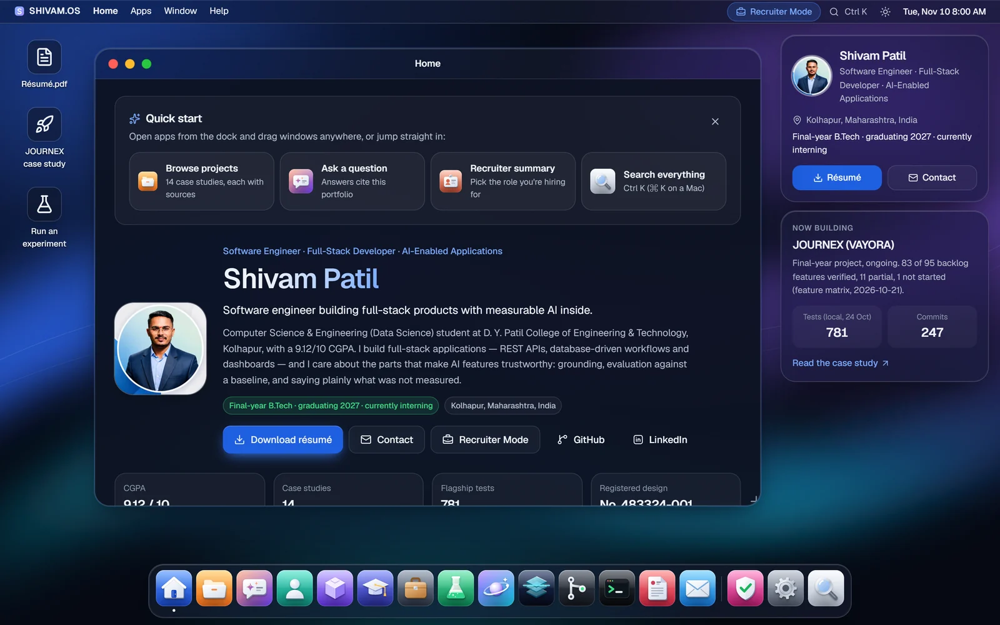

## ✦ What is this?

SHIVAM.OS presents the work of **Shivam Patil** — final-year B.Tech CSE (Data Science) at D. Y. Patil College of Engineering & Technology, Kolhapur — as a small operating system. Open apps from the dock, drag windows around, search everything with <kbd>Ctrl</kbd>/<kbd>⌘</kbd> <kbd>K</kbd>, or switch to **Recruiter Mode** for a one-page summary tailored to a role.

It is built to be **verifiable**, not just pretty: results carry their sources, simulated or unbuilt parts are labelled as such, unknown details are shown as placeholders, and the site publishes its own dated test report.

<table>
<tr>
<td width="33%" valign="top">

**🪟 A real window manager**<br />
Drag, resize, snap, minimise, maximise, stack, overview, keyboard control and off-screen protection — plus browser-back support and shareable URLs.

</td>
<td width="33%" valign="top">

**📱 A purpose-built phone UI**<br />
Not a shrunken desktop: a home screen, a quick dock, full-screen apps with back navigation, and touch-sized targets.

</td>
<td width="33%" valign="top">

**🧪 Evidence everywhere**<br />
Every case study has problem, contribution, trade-offs, tests, measured results, limitations and links to source.

</td>
</tr>
</table>

## ✦ Tour

<table>
<tr>
<td width="50%" valign="top">
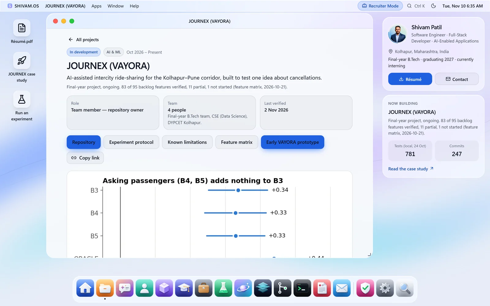
<p><b>Case studies</b> — 14 projects, each with a shareable URL (<code>/projects/journex</code>), architecture, an evolution timeline from real commits, and an evidence tab.</p>
</td>
<td width="50%" valign="top">
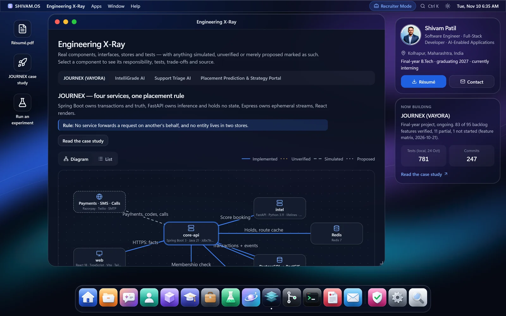
<p><b>Engineering X-Ray</b> — interactive architecture diagrams: responsibilities, interfaces, tests, trade-offs and source links. Simulated, unverified and proposed parts are marked.</p>
</td>
</tr>
<tr>
<td width="50%" valign="top">
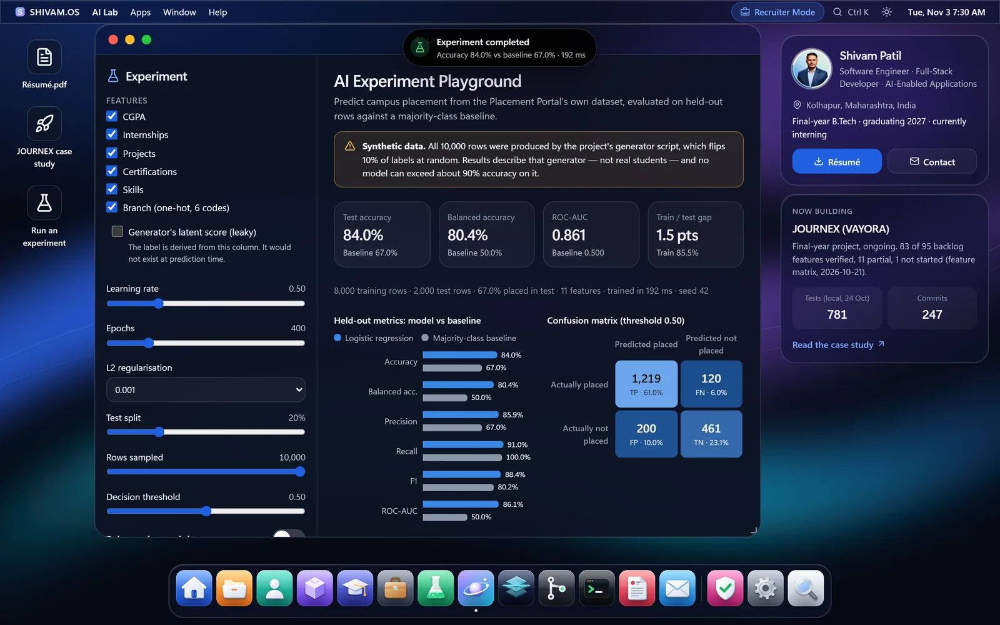
<p><b>AI Lab</b> — logistic regression vs. a majority baseline on the Placement Portal's dataset, trained in a Web Worker; tweak features, leakage, class weights and threshold. Cross-checked against scikit-learn.</p>
</td>
<td width="50%" valign="top">
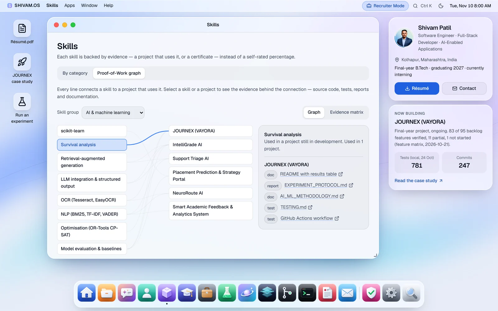
<p><b>Proof-of-Work graph</b> — no self-rated percentages: every skill links to the projects that use it and the evidence behind them.</p>
</td>
</tr>
<tr>
<td width="50%" valign="top">
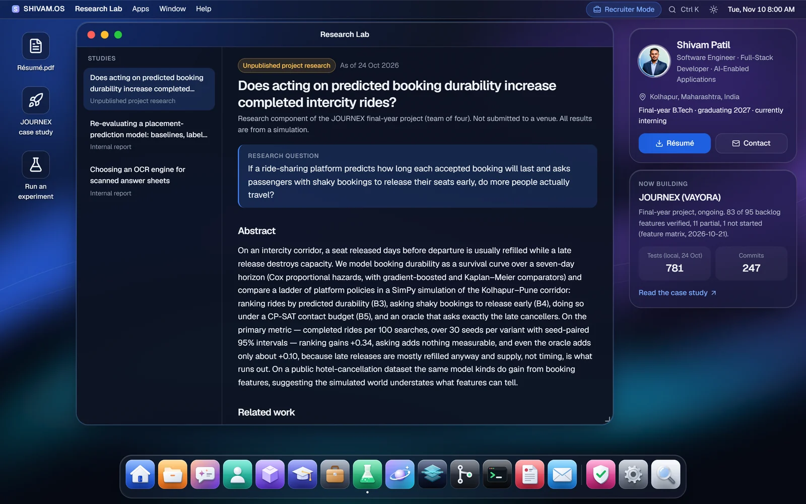
<p><b>Research Lab</b> — questions, methods, datasets, baselines, results tables and threats to validity, including a reported <i>negative</i> result.</p>
</td>
<td width="50%" valign="top">
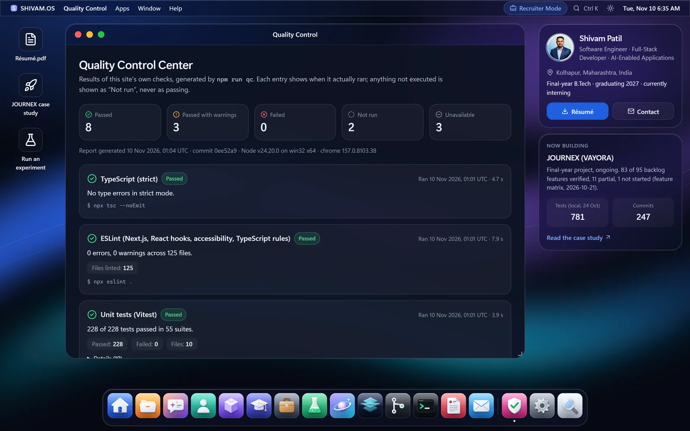
<p><b>Quality Control Center</b> — the site's own dated test report. Checks that were not run are shown as “Not run”, never as passing.</p>
</td>
</tr>
</table>

<p align="center">
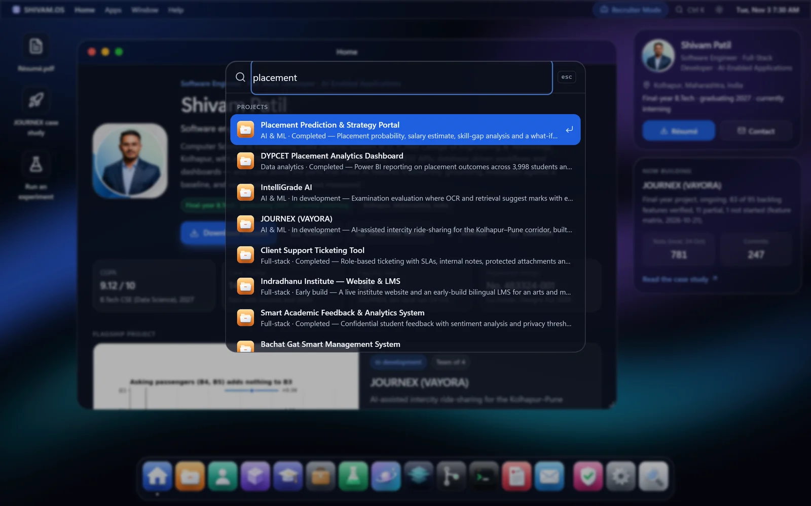<br />
<sub><b>Spotlight</b> — <kbd>Ctrl</kbd>/<kbd>⌘</kbd> <kbd>K</kbd> searches apps, projects, skills, research, credentials and quick actions.</sub>
</p>

### On a phone

<p align="center">
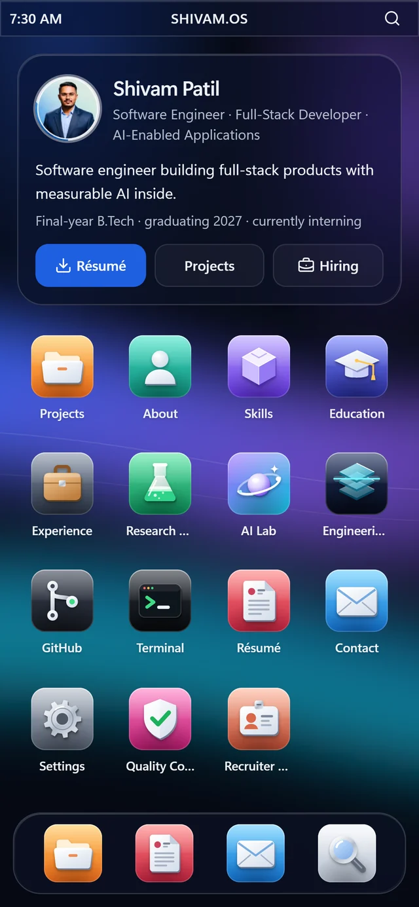
&nbsp;
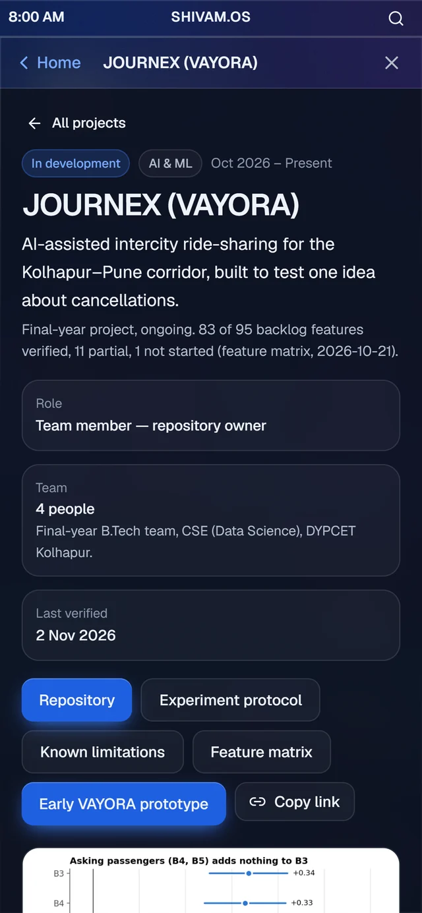
&nbsp;
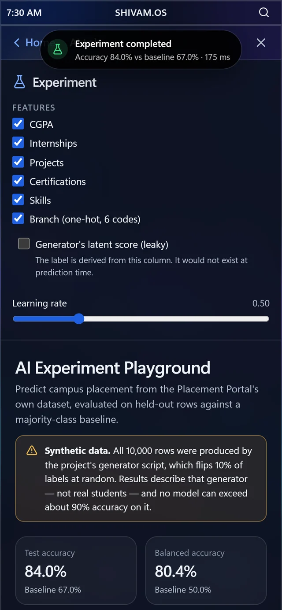
</p>

## ✦ The apps

| | App | What it does |
|:--:|---|---|
| 🏠 | **Home** | Introduction, flagship project, key numbers, résumé and contact shortcuts |
| 🗂️ | **Projects** | Search, category / status / technology filters, sorting, 14 full case studies |
| 👤 | **About** | Engineering journey, interests, problem-solving philosophy, leadership |
| 🧩 | **Skills** | Skills by evidence level and the Proof-of-Work graph with a matrix view |
| 🎓 | **Education** | Degree, CGPA, certifications, a registered design, awards, hackathons |
| 💼 | **Experience** | Internships, leadership roles and job simulations (labelled as such) |
| 🧪 | **Research Lab** | Three studies with method, results, reproducibility and limitations |
| 🪐 | **AI Lab** | A bounded, reproducible ML experiment with a baseline and a leakage demo |
| 🔬 | **Engineering X-Ray** | Architecture diagrams for four systems, with a list view |
| 🌿 | **GitHub** | Live repositories with a dated offline snapshot and the latest CI run |
| ⌨️ | **Terminal** | Predefined, read-only commands — `help`, `projects journex`, `open xray`… |
| 📄 | **Résumé** | PDF preview, download, print and an accessible text version |
| ✉️ | **Contact** | Validated form that never claims delivery unless the provider accepted it |
| ⚙️ | **Settings** | Theme, glass material, accent, wallpaper, motion and dock |
| 🛡️ | **Quality Control** | Dated results of typecheck, lint, tests, accessibility, performance, links and audit |
| 🤝 | **Recruiter Mode** | Role-focused summaries for full-stack, software-engineering and data/ML roles |

## ✦ How it is built

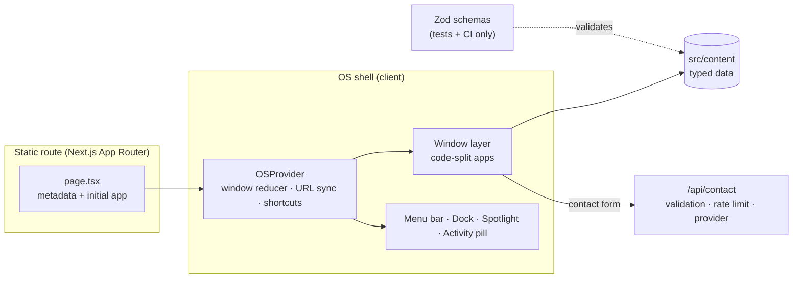

- **Static first.** Every page is prerendered; each route server-renders the app it opens, so content is in the HTML before JavaScript loads.
- **Code-split apps.** Opening an app loads only that app; Spotlight and its index load on first use.
- **Pure state.** The window manager is a reducer with clamping and focus rules, unit-tested in isolation.
- **No validator in the browser.** Content is plain typed data; Zod schemas run in the test suite and CI.
- **Accessible by construction.** Real buttons and menus, roving focus, focus traps and restoration, live regions, reduced-motion support, table views for charts.

<details>
<summary><b>Tech stack</b></summary>

<br />

| Layer | Choice |
|---|---|
| Framework | Next.js 16 (App Router, static prerendering), React 19 |
| Language | TypeScript 6 — `strict`, `noUncheckedIndexedAccess` |
| Styling | Tailwind CSS 4, CSS custom properties for themes, glass and accents |
| Motion | Motion for React (`LazyMotion` + DOM features only) |
| Forms & validation | React Hook Form, Zod |
| Icons | 17 original SVG app icons; Lucide for UI glyphs |
| Testing | Vitest + Testing Library, Playwright (desktop + Pixel 7), axe-core |
| Hosting | Vercel (any Node 20.9+ host works) |

TypeScript 6 is used rather than 7 because Next.js's build type-check and typescript-eslint rely on the JavaScript compiler API.
</details>

<details>
<summary><b>Project structure</b></summary>

```
src/
  app/            routes, metadata (sitemap, robots, manifest, OG image), contact API
  os/             shell: window manager, dock, menu bar, Spotlight, overlays, routing
  os/state/       pure reducers and stores (windows, preferences, activity)
  apps/<app>/     one folder per app, code-split and loaded on demand
  design/         UI primitives, the original icon family, wallpapers
  content/        typed personal content + Zod schemas
  lib/            search, terminal, filtering, ML, contact, server-only code
scripts/          QC report, perf probe, link check, GitHub snapshot, screenshots, ML reproduction
tests/unit/       Vitest
tests/e2e/        Playwright with axe-core scans
docs/             deployment and content guides, README assets
```
</details>

## ✦ Quality

Measured by `npm run qc` on **2 November 2026** (Node 24, Windows, Chrome 156). The full report ships with the site and appears in the **Quality Control** app.

| Check | Result |
|---|---|
| TypeScript strict | ✅ 0 errors |
| ESLint | ✅ 0 errors, 0 warnings, no suppressions |
| Unit tests | ✅ 182 / 182 |
| End-to-end (desktop + mobile) | ✅ 215 / 215, 0 flaky |
| Accessibility (axe-core, WCAG 2.2 A/AA) | ✅ 0 violations in 68 scans — 17 routes, light & dark, desktop & mobile |
| Performance (lab, throttled mobile) | ⚠️ LCP 0.25–1.24 s, CLS 0; blocking time 145–216 ms (two pages just over 200 ms) |
| Links | ⚠️ 0 broken of 93; LinkedIn and LeetCode block automated checks |
| Dependencies | ⚠️ 0 production advisories; 16 moderate in dev-only ESLint tooling |
| CI (GitHub Actions, Ubuntu) | ✅ First run passed: install, typecheck, lint, unit, build, Playwright |
| Not run | Screen readers, real iOS/Android devices, live contact delivery |

The AI Lab's TypeScript model agrees with scikit-learn on identical rows: **ROC-AUC 0.8607** in both; accuracy 0.8400 vs 0.8385.

## ✦ Honest by design

- JOURNEX's research is reported as unpublished, with its **negative result** — and its failing CI job is stated.
- IntelliGrade's AI marking is described as **unmeasured** (the LLM provider was never called live).
- The Placement Portal's reported 95.11% accuracy is shown next to the **majority baseline it does not beat**.
- Commits co-authored with an **AI coding assistant are disclosed** per project.
- The registered design is called a **design registration, not a patent**.
- Private repositories are not linked, and the phone number is not shown on the site.

## ✦ Run it locally

> Requires **Node.js 20.9+** (developed on Node 24).

```bash
git clone https://github.com/shivampatil4972/Shivam_OS.git
cd Shivam_OS
npm install
npm run dev        # → http://localhost:3000
```

> [!TIP]
> On Windows, if PowerShell says *“running scripts is disabled”*, use `npm.cmd` instead of `npm`, or run once: `Set-ExecutionPolicy -Scope CurrentUser RemoteSigned`.

| Command | Purpose |
|---|---|
| `npm run dev` | Development server |
| `npm run build` · `npm start` | Production build and server |
| `npm test` | Unit tests |
| `npm run test:e2e` | Playwright suite (first run: `npx playwright install chromium`, or set `E2E_CHANNEL=chrome`) |
| `npm run qc` | Run every check and refresh the Quality Control report |
| `npm run snapshot:github` | Refresh the GitHub fallback snapshot |
| `node scripts/readme-screenshots.mjs --base <url>` | Regenerate the screenshots in this README |

Deployment, environment variables and custom domains: **[docs/DEPLOYMENT.md](docs/DEPLOYMENT.md)** · Editing content: **[docs/CONTENT.md](docs/CONTENT.md)**

<details>
<summary><b>Keyboard shortcuts</b></summary>

<br />

| Keys | Action |
|---|---|
| <kbd>Ctrl</kbd>/<kbd>⌘</kbd> <kbd>K</kbd> | Spotlight |
| <kbd>Alt</kbd> <kbd>Shift</kbd> <kbd>W</kbd> / <kbd>M</kbd> / <kbd>F</kbd> | Close / minimise / maximise the focused window |
| <kbd>Alt</kbd> <kbd>Shift</kbd> <kbd>←</kbd> <kbd>→</kbd> | Snap left / right |
| <kbd>Alt</kbd> <kbd>Shift</kbd> <kbd>`</kbd> | Cycle windows |
| <kbd>Alt</kbd> <kbd>Shift</kbd> <kbd>O</kbd> | Window overview |
| <kbd>Alt</kbd> <kbd>Shift</kbd> <kbd>1</kbd>–<kbd>9</kbd> | Open dock apps |
| <kbd>Alt</kbd> <kbd>Shift</kbd> <kbd>?</kbd> | Show all shortcuts |
| Arrow keys on a window title | Move the window (the corner handle resizes) |
</details>

<details>
<summary><b>Known limitations</b></summary>

<br />

- **Contact delivery** needs a Formspree or Resend account; until then the form says nothing was sent.
- **Not tested** on real iOS/Android devices, in Safari/WebKit or Firefox, or with screen readers.
- **Performance numbers** are lab measurements on one machine, not field data.
- **CSP** allows inline scripts, which statically prerendered Next.js pages need without per-request nonces.
- The contact **rate limit** is in memory, so on serverless hosts it applies per instance.
- The **GitHub** app falls back to a dated snapshot when the API is unreachable or rate-limited.
- The **AI Lab** dataset is synthetic; results describe the project's data generator, not real students.
- Some details only the owner can confirm are shown as **placeholders** (see Quality Control → Content integrity).
- ESLint is pinned to 9.x until `eslint-plugin-react` and `jsx-a11y` support ESLint 10.
</details>

## ✦ Contact

<p>
<a href="mailto:shivampatil4972@gmail.com"></a>
<a href="https://www.linkedin.com/in/shivam-patil-b47189210"></a>
<a href="https://github.com/shivampatil4972"></a>
<a href="https://leetcode.com/u/shivam_patil_07"></a>
</p>

<br />

<div align="center">
<sub>Inspired by modern Apple platforms; every icon, wallpaper and asset here is original. SHIVAM.OS is not affiliated with, endorsed by or sponsored by Apple Inc.<br />Content, photographs and résumé © Shivam Patil. All rights reserved.</sub>
</div>
